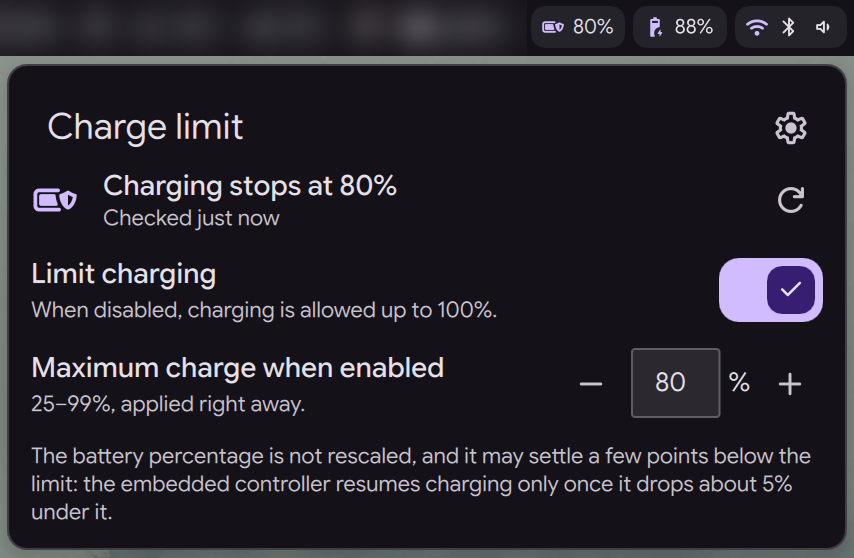
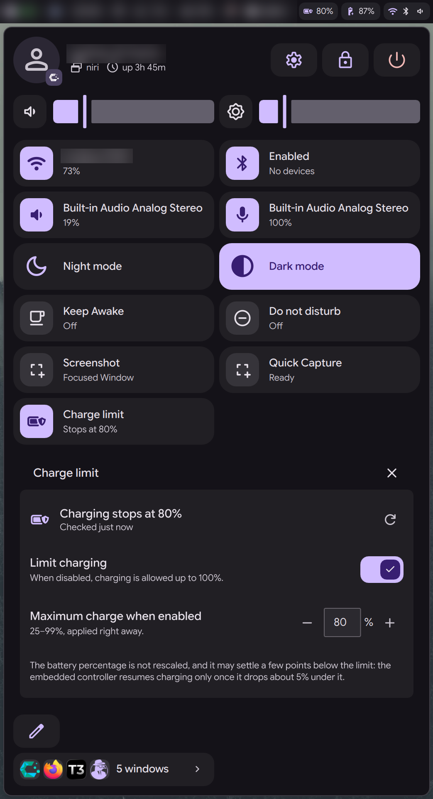
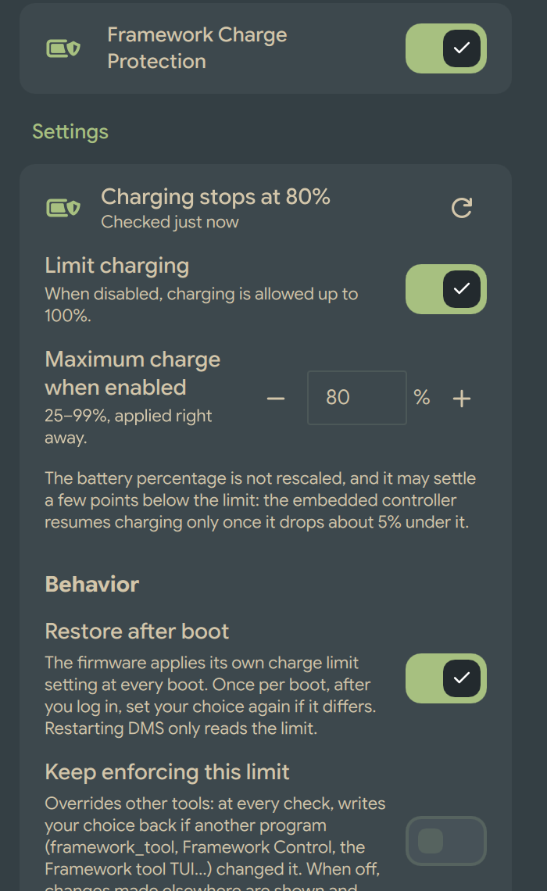

# Framework Charge Limit for DMS

A [Dux Shell (DMS)](https://duxlabs.dev/docs/dms/) plugin that controls the battery charge limit
of Framework laptops from the bar, the Control Center and the settings page:

- **Limit charging** on: the embedded controller (EC) stops charging at your chosen maximum
  (25–99%, 80% by default);
- **Limit charging** off: the maximum is set to 100%;
- optionally, your choice is set again once after each boot, since the firmware applies its own
  charge limit setting at startup.

It works where DMS's own charge limit setting cannot: many Framework kernels expose no
`charge_control_end_threshold` file, but the EC is reachable through `/dev/cros_ec`, which
Framework's official [`framework_tool`](https://github.com/FrameworkComputer/framework-system)
uses. The plugin runs that tool through a small root helper (see [Privileges](#privileges)).

This is a community plugin, not affiliated with Framework Computer.






## Requirements

- DMS 2.1 or later.
- A Framework laptop. The plugin refuses to load on other hardware (DMI vendor check).
- `framework_tool` from **framework-system**, root-owned in `/usr/bin` or `/usr/local/bin`
  (Arch/CachyOS: `pacman -S framework-system`; other distributions: your package, or the
  [release binary](https://github.com/FrameworkComputer/framework-system/releases) copied to
  `/usr/local/bin` as root). A copy in your home directory is never used.
- polkit (`pkexec`, `pkcheck`) and a polkit agent: DMS is one.
- bash and util-linux (`flock`).
- A writable `/usr/local` and `/usr/share/polkit-1/actions`: the helper installer does not
  support NixOS or image-based systems with a read-only `/usr`.

Tested on a Framework Laptop 13 Pro (Intel Core Ultra Series 3), BIOS 03.04, CachyOS, with
framework-system 0.6.6.

## Installation

From DMS: Settings → Plugins → browse → *Framework Charge Limit*. Or by hand:

```sh
git clone https://github.com/hbouttev/dms-framework-charge-limit \
    ~/.config/dms/plugins/frameworkChargeLimit
```

then enable it in Settings → Plugins, and add the *Framework Charge Limit* widget to a bar
(Settings → Bar widgets) and/or to the Control Center (edit mode → add widget).

The first time you turn **Limit charging** on, from the pill, the Control Center tile or the
settings page, DMS asks for your administrator password to install the helper, then applies your
choice. Cancelling changes nothing. The settings page also has *Install helper*,
*Update helper* and *Remove helper* buttons.

## Surfaces

| Surface | Behaviour |
| --- | --- |
| Bar pill | Shield icon and the limit while charging is limited; plain battery while charging up to 100%; question mark while setup is needed; warning icon when the limit cannot be read. Click: toggle the limit. Right click: popout. Both can be swapped in the settings. |
| Popout | Status, **Limit charging**, **Maximum charge when enabled**, a re-read button and a link to the settings. |
| Control Center tile | Click: toggle. Detail page: the same controls as the popout. |
| Settings | The same controls, then the options below, and the helper's status and buttons. |
| IPC | `dms ipc call frameworkChargeLimit status \| enable \| disable \| toggle \| limit <25-99> \| refresh`. These never ask for a password: without the helper they only say so. |

## How it behaves

| You do | The EC maximum becomes |
| --- | --- |
| Turn **Limit charging** on | your maximum (80% by default) |
| Turn it off | 100% |
| Change the maximum while on | the new maximum, right away |
| Change the maximum while off | unchanged; the value is saved for next time |

Every write is read back from the EC; a value that does not match is reported as an error,
never as success. The toggle shows the hardware, not the last request.

The displayed battery percentage is not rescaled: at an 80% limit DMS still shows about 80%.
Leave DMS's *Scale battery level to charge limit* off. The EC keeps the charge between about
the limit minus 5% and the limit, so the battery can sit a few points under it.

### Changes made by other tools

The plugin reads the EC every 5 minutes (configurable), when the popout opens, and after
resume. When another program (framework_tool, the Framework tool TUI, Framework Control…)
changed the limit, the plugin follows it by default:

- 100% (or the EC's "no limit"): **Limit charging** shows off; your saved maximum is kept.
- 25–99%: **Limit charging** shows on, at that maximum.
- 20–24% (possible with other tools): shown as is and never rounded; your saved maximum is kept.
- Anything else, or a failed read: an unknown or error state, never "off".

**Keep enforcing this limit** (off by default) writes your choice back at each check instead,
and says so in a notification. If Framework Control's battery charge limit is enabled, it
reapplies its own value every ten minutes; turn one of them off rather than letting both fight.
The plugin warns when it corrects the limit repeatedly.

### After boot

The firmware applies its charge limit setting (BIOS setup) at every boot, replacing what was set
from Linux or Windows. With **Restore after boot** on (default), the plugin sets your choice
again once per boot, after you log in, if the EC reports something else, with a notification.
Restarting or reloading DMS during the same boot only reads the limit (the boot is identified
by `/proc/sys/kernel/random/boot_id`). Temporary failures right after login are retried for
about 4 minutes. Nothing runs before login, and nothing runs under Windows.

### Turning the plugin off

With **Allow full charge when turned off** on (default), disabling the plugin in DMS, uninstalling
it, or removing its helper sets the maximum back to 100% if charging is limited. Logging out,
shutting down, or restarting/reloading DMS never changes the limit: the EC keeps it.

Uninstalling the plugin from DMS also shows a notification offering to remove the system
helper (which asks for the administrator password).

## Privileges

Reading or changing the limit needs root. The helper is installed by
[`helper/install.sh`](helper/install.sh) through `pkexec`, with your administrator password:

| File | Purpose |
| --- | --- |
| `/usr/local/libexec/dms-framework-charge-limit/charge-limit` | the helper, root-owned ([source](helper/charge-limit)) |
| `/usr/local/libexec/dms-framework-charge-limit/uninstall` | removes all three files ([source](helper/uninstall)) |
| `/usr/share/polkit-1/actions/io.github.hbouttev.dms-framework-charge-limit.policy` | polkit action ([source](helper/polkit.policy)) |

- The helper accepts only `get`, `set <25-100>` and `info`, validates its arguments, and runs
  nothing but `framework_tool --charge-limit [N]`, using a `framework_tool` that only root can
  modify, in a fixed list of system directories. It exits after each operation; no service runs.
- The polkit action lets the **active local session** run that one root-owned file through
  `pkexec` without a password, like changing the power profile. Inactive and remote sessions
  need an administrator password. The plugin's own directory, which you can write to, is never
  run as root without a password.
- Background checks call `pkcheck` first and never start `pkexec` when it would ask for a
  password, so no authentication dialog ever appears unless you click to install, update or
  remove the helper.
- Each operation is logged by pkexec in the system journal (one line per check).

### Removing the helper by hand

```sh
pkexec /usr/local/libexec/dms-framework-charge-limit/uninstall
```

or, if that file is gone:

```sh
sudo rm -rf /usr/local/libexec/dms-framework-charge-limit \
    /usr/share/polkit-1/actions/io.github.hbouttev.dms-framework-charge-limit.policy
```

Neither changes the charge limit or removes framework-system.

## Troubleshooting

- `dms ipc call frameworkChargeLimit status` prints the state, the last error and the
  helper status as JSON.
- Plugin logs: `journalctl --user -u dms | grep frameworkChargeLimit`.
- *polkit did not allow the helper without a password*: the session is not the active local one,
  or a local polkit rule overrides the action; check with
  `pkcheck --action-id io.github.hbouttev.dms-framework-charge-limit.charge-limit --process $$`.
- *framework_tool could not communicate with the embedded controller*: try
  `sudo framework_tool --charge-limit` in a terminal.

## Development

```sh
node tests/run.mjs                                  # logic and helper tests (fake framework_tool)
node tests/typecheck.mjs                            # JSDoc types (TypeScript through npx)
dms ipc call plugins reload frameworkChargeLimit
```

[`logic/ChargeLimit.js`](logic/ChargeLimit.js) holds the pure logic (parsing, classification,
reconciliation, commands), typed with JSDoc and checked by editors through `jsconfig.json`;
`ChargeDaemon.qml` owns all state and hardware access;
`ChargeWidget.qml` (bar and Control Center), `ChargeSettings.qml` and `ChargeControls.qml` only
render it. When the helper changes, bump `HELPER_VERSION` in both `helper/charge-limit` and the
logic file; the settings page then offers *Update helper*.

## License

MIT
